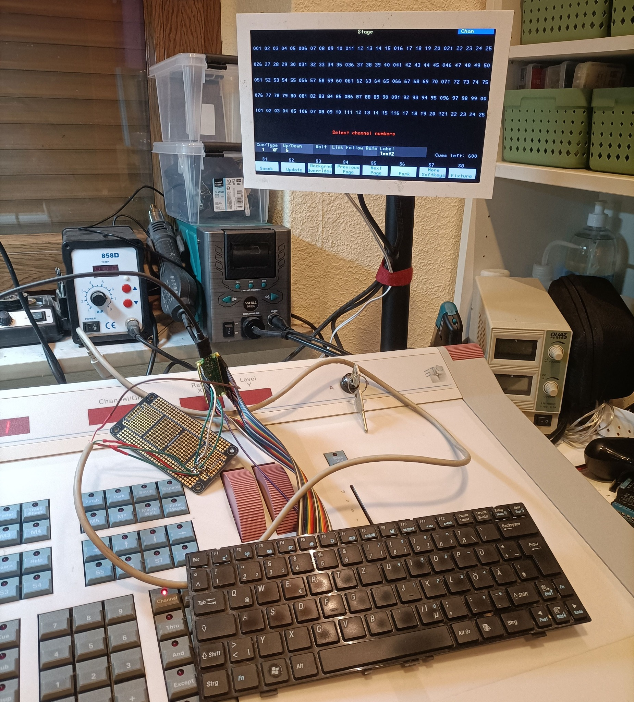

# Nerdy Keyboard Mapper

**Firmware: 1.0.0 (Release Candidate)** · Raspberry Pi Pico · USB-HID + PS/2

Turn a salvaged **passive laptop keyboard matrix** into a keyboard for modern PCs (**USB HID**) and older hardware (**PS/2**). Both outputs can run at the same time on a Raspberry Pi Pico.



**Why?** Old hardware can keep being useful. This project was made to reuse discarded laptop keyboards, not to sell a universal keyboard adapter.

## Features

- Read an unknown 24-pin passive keyboard matrix using 24 Pico GPIOs.
- Learn and store up to 160 matrix contacts in emulated EEPROM.
- Convert saved names into USB HID keys and PS/2 scan code set 2.
- Output to **both interfaces simultaneously**, including modifiers and several special keys.
- Detect ambiguous matrix states to avoid ghost keys when no diodes are present.
- Autostart on USB and PS/2; serial console for mapping and configuration.
- German ISO QWERTZ physical-key mapping (host OS needs matching layout).

## Hardware

- Raspberry Pi Pico (RP2040)
- Passive laptop keyboard with a 24-contact FPC connector, matching adapter breakout
- 24 wires from FPC breakout to Pico matrix GPIOs
- Two 2N7002 MOSFETs and four 10 kΩ resistors for bidirectional 3.3 V/5 V PS/2 level shifting
- Common ground between Pico and PS/2 host
- USB cable; PS/2 cable to the host

**GPIO assignment (example build):** FPC contacts 1–23 map to GP0–GP22, and FPC contact 24 to GP26. **Verify and adapt `gpio[]`** in `00_Config.h` for your actual wiring. PS/2 CLOCK = GP27, DATA = GP28. The FPC numbering shown is the numbering assigned by your breakout, not a universal laptop-keyboard pinout.

### PS/2 wiring and safety

Each PS/2 signal uses one 2N7002: gate to 3.3 V; source to the Pico GPIO; drain to the 5 V PS/2 host signal. A 10 kΩ pull-up goes from source to 3.3 V, and another from drain to 5 V. Common ground is mandatory. The firmware drives GPIOs LOW or high impedance, **never actively 5 V**.

For a conventional 6-pin mini-DIN keyboard connector: pin 1 DATA, pin 3 GND, pin 4 +5 V, pin 5 CLOCK. **Confirm the connector orientation and pin numbering before powering anything.** Do not connect the PS/2 host's 5 V directly to Pico GPIOs. The Pico must have a suitable 5 V/USB supply. If powering the Pico from the PS/2 host, use a correctly engineered power input, not a GPIO or the pull-ups.

## Arduino IDE setup

1. Install [Arduino-Pico by Earle F. Philhower](https://github.com/earlephilhower/arduino-pico).
2. Select **Raspberry Pi Pico** and **Tools → USB Stack → Pico SDK**.
3. Open `NerdyKeyboardMapper/NerdyKeyboardMapper.ino`. The adjacent `.h` files are part of the sketch and must stay in the same directory.
4. Back up existing assignments over USB serial with `:export` before updating firmware.
5. Upload and test USB HID first; PS/2 after checking wiring and idle voltages.

> The modularized firmware has been tested successfully on the actual Raspberry Pi Pico setup with USB HID and the ETC Expression 2X over PS/2. Release-candidate status means further testing on other keyboard matrices and PS/2 hosts is welcome.

## Serial commands

| Command | Purpose |
| --- | --- |
| `:help` | Show commands |
| `:list` / `:export` | Inspect or back up saved key names |
| `:usb on` / `:usb off` / `:usb status` | USB HID output |
| `:ps2 on` / `:ps2 off` / `:ps2 status` | PS/2 output |
| `:test` / `:test off` | Toggle multi-key scanning / mapping mode |
| `:edit` / `:rename N NAME` / `:remap N` / `:delete N` | Edit key mappings in mapping mode |
| `:init CONFIRM` / `:erase CONFIRM` | **Destructive:** initialize/erase mapping only when explicitly intended |

For initial mapping or editing, disable both keyboard outputs, then use the console and press one key at a time. Keep a copy of `:export` output. Unrecognized key labels may not emit USB/PS/2 events; the recognized aliases are in `30_UsbHid.h` and `40_Ps2Device.h`.

The scanner deliberately blocks ambiguous matrix combinations (ghosting). Special laptop Fn keys only work where implemented in firmware. USB and PS/2 receive keystrokes simultaneously; be careful when both hosts are active.

## File structure

```text
NerdyKeyboardMapper/
  NerdyKeyboardMapper.ino     startup + main loop
  00_Config.h                hardware and EEPROM structure
  10_MatrixAndDatabase.h     matrix probing + EEPROM database/editing
  20_KeyScanner.h            multi-key scanner and ghosting guard
  30_UsbHid.h                USB HID mapping and key events
  40_Ps2Device.h             PS/2 set-2 protocol and keyboard queue
  50_SerialConsole.h         command parser
docs/
  etc-expression-keyboard.jpg
  MIGRATION.md
```

## Versioning

Firmware version is `1.0.0` (Release Candidate). It is displayed on the serial console at startup and defined as `FIRMWARE_VERSION` in `00_Config.h`. The independent EEPROM schema constant `VERSION = 1` must remain unchanged for compatibility with existing stored mappings.

## License

MIT, see [LICENSE](LICENSE).
